# ethrag

Citation-verified retrieval-augmented Q&A over Ethereum specifications (EIPs, ERCs, consensus


## For the lay reader

- [docs/diagrams/explainer.svg](docs/diagrams/explainer.svg) &mdash; a one-page
  summary in ordinary words: the question, one chart, the finding, and why it
  matters. No background assumed.
- [GLOSSARY.md](GLOSSARY.md) &mdash; every abbreviation this repo uses, defined.
- [What does all this mean?](https://claude.ai/artifact/Mctu5EP8YgfjGx6fcCHDgs)
  &mdash; the across-the-whole-project explainer, with all six repos on one page.
specs, Flashbots docs). Generation is untrusted; a **deterministic verifier** decides whether a
draft is released: every sentence must be cited, every citation must have been retrieved, and
every number, hex value, `2**n` and `ALL_CAPS` identifier in the answer must be found in the
cited chunk, next to the name it is claimed for. Anything else is withheld.

* numpy is the only required dependency; the LLM and embedding paths are optional extras.
* 901 documents / 17,387 chunks, an offline eval set of 504 questions with a stored train/test
  split, 312 tests at 99.3% coverage, all runnable without network or API key.
* Python 3.10 - 3.13. MIT.

```
$ ethrag ask --explain "What is the BASE_FEE_MAX_CHANGE_DENOMINATOR in EIP-1559?"
BASE_FEE_MAX_CHANGE_DENOMINATOR is 8 [eip-1559#011].
verdict: VERIFIED
  [ok  ] s0 8                            <- eip-1559#011 (exact) bound  | BASE_FEE_MAX_CHANGE_DENOMINATOR = 8
  [ok  ] s0 base_fee_max_change_denominator <- eip-1559#011 (exact)  | BASE_FEE_MAX_CHANGE_DENOMINATOR = 8
```

Each claim is listed with the chunk and the source line that supports it. A wrong draft
(`... is 16`) prints `[FAIL]`, the issue `unsupported claim '16' not found in cited chunks`, and
the answer text is replaced by "I can't give a verified answer" (exit code 2).

## Install and use

```bash
pip install -e ".[dev]"                          # numpy only; add ,llm for the Anthropic generator
ethrag build-index --data data --out .index      # ~11 s, 43 MB, once
ethrag ask --index .index "What is the history serve window in EIP-2935?"
ethrag ask --index .index --explain "What opcode number does BASEFEE use?"
ethrag ask --index .index --rerank evals/artifacts/reranker.json "..."   # trained reranker
ethrag related eip-4844 --depth 2 --index .index                         # citation graph
ethrag stats --index .index
ANTHROPIC_API_KEY=... ethrag ask --llm --index .index "How many field elements are in a blob?"
```

Without `--index` the corpus in `data/` is chunked and indexed on every start (about 10 s). Exit
code 0 = verified, 2 = withheld, 1 = usage error (missing index, key, ...).
`ETHRAG_DATA`, `ETHRAG_INDEX` and `ETHRAG_MODEL` set defaults.

Interfaces:

```bash
ethrag serve --index .index --port 8080       # stdlib HTTP JSON API
curl 'localhost:8080/ask?q=What+is+PTC_SIZE+in+EIP-7732%3F'
curl -X POST localhost:8080/ask -d '{"question": "What is the history serve window in EIP-2935?", "k": 5}'
curl 'localhost:8080/search?q=blob+versioned+hash&k=3'   # retrieval only
curl 'localhost:8080/related?doc=eip-1559&depth=2'       # citation graph
```

```bash
ethrag mcp --index .index                     # MCP stdio server: ask_eips, search_eips, related_eips
# client config: {"mcpServers": {"ethrag": {"command": "ethrag", "args": ["mcp", "--index", "/abs/.index"]}}}
```

```python
from ethrag import RagPipeline
p = RagPipeline.from_index(".index")
a = p.ask("What is the BASE_FEE_MAX_CHANGE_DENOMINATOR in EIP-1559?")
a.verified, a.text, a.provenance, a.verification.claims
```

`docker build -t ethrag . && docker run --rm -p 8080:8080 ethrag` serves the API with the index
baked in (the Dockerfile is not exercised in this repository's local checks, see CI).

## Architecture

```
 OFFLINE, ONCE
   data/*.md --> ingest --------------> chunks (prose | code | table) + front-matter metadata
   901 docs      headings, atomic          |
                 tables/code blocks        +--> BM25 index (title + section field boosts)
                                           +--> hashed dense index (word + char-trigram tf-idf)
                                           +--> citation graph (requires / EIP-N mentions)
                 ethrag build-index  -->  .index/ { arrays.npz, chunks.json, meta.json }

 PER QUESTION
   question --> plan: EIP-N / ERC-N named in the query
            --> BM25 ranking --+
            --> dense ranking -+--> weighted RRF (w = 0.5) + boost for the named EIP's chunks
            --> [logistic reranker over the top 50]  --> top-k (5) --> [+ requires-graph neighbours]
            --> generator:  LLM draft ending every sentence in [doc#NNN]
                            | offline extractive answerer (NAME is value / best sentence)
            --> VERIFIER (no model, no network)
                  every sentence cited . every citation retrieved . every token in the cited chunk
                  value bound to its name . units and ranges agree . negation . coverage . relevance
            --> VERIFIED answer + per-claim provenance (exit 0)   |   WITHHELD + issues (exit 2)
```

### Diagrams

How a question flows through the system:



What to do when something looks wrong (real symptoms and messages, one fix per leaf; the Mermaid
sources and a table of verifier issue strings are in [docs/FLOWCHARTS.md](docs/FLOWCHARTS.md)):


## Results

Everything below is from `python evals/run_evals.py` and `python evals/run_verifier_eval.py`;
methodology, tuning, leakage controls and caveats are in [docs/EVALUATION.md](docs/EVALUATION.md).
**504 synthetic questions** mined from the corpus text (317 constant, 133 concept, 54 multi-hop),
split 353 train / 151 test with a seeded split stored in the file (single-hop questions are split
by gold document). Fusion weights and the reranker are fit on **train only**.

**Retrieval, TEST split (n = 151)**; a hit is a retrieved chunk of the gold document containing the
gold text:

| system | R@1 | R@3 | R@5 | R@10 | MRR@10 | nDCG@10 |
|---|---|---|---|---|---|---|
| bm25 | 0.424 | 0.702 | 0.788 | 0.901 | 0.579 | 0.622 |
| dense(hashed) | 0.325 | 0.483 | 0.609 | 0.742 | 0.444 | 0.467 |
| hybrid | 0.437 | 0.715 | 0.815 | 0.940 | 0.594 | 0.649 |
| hybrid+rerank | 0.695 | 0.894 | 0.934 | 0.987 | 0.801 | 0.814 |
| hybrid+graph | 0.437 | 0.715 | 0.815 | 0.901 | 0.590 | 0.635 |

**Retrieval, TRAIN split (n = 353)**

| system | R@1 | R@3 | R@5 | R@10 | MRR@10 | nDCG@10 |
|---|---|---|---|---|---|---|
| bm25 | 0.518 | 0.725 | 0.819 | 0.918 | 0.640 | 0.676 |
| dense(hashed) | 0.442 | 0.586 | 0.660 | 0.756 | 0.533 | 0.543 |
| hybrid | 0.513 | 0.737 | 0.847 | 0.946 | 0.648 | 0.684 |
| hybrid+rerank | 0.717 | 0.895 | 0.958 | 0.980 | 0.814 | 0.832 |
| hybrid+graph | 0.513 | 0.737 | 0.847 | 0.901 | 0.643 | 0.670 |

**Multi-hop doc-set recall** (every gold document in the top k; test n = 16, train n = 38):

| system | n | docset@5 | docset@10 | R@10 |
|---|---|---|---|---|
| train: bm25 | 38 | 0.605 | 0.816 | 1.000 |
| train: dense(hashed) | 38 | 0.553 | 0.737 | 0.921 |
| train: hybrid | 38 | 0.579 | 0.684 | 0.947 |
| train: hybrid+rerank | 38 | 0.737 | 0.974 | 0.974 |
| train: hybrid+graph | 38 | 0.579 | 0.763 | 0.921 |
| test: bm25 | 16 | 0.500 | 0.750 | 0.938 |
| test: dense(hashed) | 16 | 0.562 | 0.688 | 0.812 |
| test: hybrid | 16 | 0.625 | 0.688 | 1.000 |
| test: hybrid+rerank | 16 | 0.812 | 0.938 | 1.000 |
| test: hybrid+graph | 16 | 0.625 | 0.625 | 0.938 |

Read it honestly:

* **Hybrid does not clearly beat BM25.** +2.6 points R@5 over raw BM25 on test, paired-bootstrap
  95% interval [-0.020, +0.073]. BM25 given the same EIP-number boost is just as good (R@5 0.821
  vs 0.815). The "dense" side is a hashed lexical baseline, not a neural embedder.
* **The learned reranker is the real gain:** R@5 0.815 -> 0.934 (+0.119, interval
  [+0.066, +0.172]). Part of that is regularity in the question generator (purpose questions
  always point at Abstract chunks; the reranker learns a section prior): without that tier R@5
  goes 0.878 -> 0.931.
* **Graph expansion did not help** here (R@5 unchanged, nDCG@10 slightly worse).
* The test split is small and the question set synthetic; development looked at both splits.
  TEST numbers are optimistic.

**Verifier, TEST split**, accept rates by case class (details and Wilson intervals in the doc):

| case | accepted | should be |
|---|---|---|
| correct reference answer | 147 / 151 = 0.974 | accepted |
| wrong value (absent from the chunk) | 0 / 117 | rejected (by construction) |
| value swapped for another literal of the same chunk | 19 / 103 = 0.184 | rejected |
| correct answer negated | 2 / 113 = 0.018 | rejected |
| no checkable token | 0 / 151 | rejected |
| question restated, no value | 33 / 151 = 0.219 | rejected |
| answer to a different question | 6 / 151 = 0.040 | rejected |
| uncited / fake citation | 0 / 151, 0 / 151 | rejected |

Pooled false-positive rate 0.052. Adding binding, units and ranges took the swap rate from 0.961
to 0.204; the relevance check took wrong-question answers from 0.987 to 0.040.

The offline extractive answerer verifies 138 of the 151 test questions, but only 75 of those
answers contain the reference value: **verified means supported by the cited text, not correct
and not necessarily responsive**.

## What the verifier does not catch

* A true-looking wrong sentence whose tokens are all present in the chunk and not tied to a
  named parameter: EIP-3541 forbids `0xEF`; "code starting with `0xFE` is rejected" verifies if
  the chunk also mentions `0xFE` ([test](tests/test_verify.py): `test_blind_spot_0xef_vs_0xfe`).
* Two values on the same source line; paraphrases that reverse meaning without a negation word;
  prose claims with no checkable token (only word overlap is checked); lexical relevance
  (`PTC_SIZE` does not answer "payload timeliness committee" for a word-matcher).
* Stale, Stagnant or Withdrawn source text (the corpus is not filtered by status).
* LLM paraphrases: untested here (no API key); `--min-coverage 0.5` is the first knob.

Full list: [docs/EVALUATION.md](docs/EVALUATION.md#6-what-the-verifier-cannot-catch).

## Corpus

901 documents (379 EIPs, 458 ERCs, 38 consensus-spec files, 26 Flashbots docs), 11.3 MB, from
public upstream repositories (CC0 / MIT), recorded with sha256 in `data/MANIFEST.json` and
rebuilt by `scripts/fetch_corpus.py`. A curated subset, not the full repositories. See
[docs/CORPUS.md](docs/CORPUS.md).

## Tests and coverage

```bash
make lint test cov          # ruff, 312 tests, coverage
make eval-gate              # held-out gates CI enforces
```

312 tests pass; coverage of `src/ethrag` is **99.3%** (line and branch combined,
99.96% line-only). The only excluded code is the optional `SentenceTransformerEmbedder`.
The network paths (`AnthropicLLM`, the real fetcher) are tested against stand-ins. CI
(`.github/workflows/ci.yml`) runs ruff, pytest with coverage and both eval gates on Python 3.10-3.13;
3.10 was not available in the environment where this was written, only 3.11-3.13 were run locally.

## Repository layout

```
src/ethrag/   ingest, graph, retrieval (BM25, hashed dense, RRF), rerank, store, verify, pipeline,
              constants, evalkit, evalgen, verifyeval, judge, llm, server, mcp_server, cli
data/         corpus + MANIFEST.json + LICENSE
evals/        questions.jsonl (+ seeds, builder), run_evals.py, run_verifier_eval.py, run_judge.py,
              results.json, verifier_results.json, artifacts/reranker.json
scripts/      fetch_corpus.py, render_diagrams.sh
docs/         EVALUATION.md, CORPUS.md, FLOWCHARTS.md, diagrams/, launch/
tests/        pytest suite (offline)
```

## Limitations

Synthetic eval set; hashed (not neural) dense retrieval; lexical verifier; extractive baseline
is weak on explanatory questions; the CLI is English-only; no streaming; the MCP server
implements tools only (no resources or prompts); the Dockerfile and the Anthropic generator
path were not exercised against live services here.

## License

MIT, copyright Ammon Jackson. Corpus documents keep their upstream licences (`data/LICENSE`).
