# Flowcharts

Two diagrams, kept as Mermaid sources in `docs/diagrams/` and rendered to SVG with
`scripts/render_diagrams.sh`. The SVGs are what the README embeds; the Mermaid below renders
natively on GitHub.

## Usage: from corpus to a verified or withheld answer

```mermaid
%% How a question becomes a verified answer (or a withheld one). Re-render: scripts/render_diagrams.sh
flowchart TD
    subgraph IDX ["1 Build the index once"]
        direction TB
        A["data/ : 901 markdown specs<br/>scripts/fetch_corpus.py rebuilds it"] --> B["ethrag build-index<br/>--data data --out .index<br/>chunks, BM25, hashed dense,<br/>citation graph"]
    end
    subgraph RET ["2 Retrieve"]
        direction TB
        D["BM25 + hashed dense<br/>weighted RRF, w = 0.5<br/>EIP-N in the question is boosted"] --> E{"--rerank<br/>weights.json?"}
        E -- yes --> F["logistic reranker<br/>rescoring top 50"]
        E -- no --> G["top-k chunks (k = 5)"]
        F --> G
    end
    subgraph GEN ["3 Generate"]
        direction TB
        H{"--llm and<br/>ANTHROPIC_API_KEY?"}
        H -- no --> I["offline extractive answer:<br/>NAME is value from a definition<br/>line, else best sentence, cited"]
        H -- yes --> J["LLM drafts an answer,<br/>every sentence ends in [doc#NNN]"]
    end
    subgraph VER ["4 Verify (deterministic, no model)"]
        direction TB
        K1["every sentence cited, every<br/>citation was retrieved"] --> K2["every number, hex, 2**n, ALL_CAPS<br/>token is in the cited chunk"]
        K2 --> K3["value is next to its name (binding)<br/>units and ranges agree"]
        K3 --> K4["negation not invented or dropped"]
        K4 --> K5["content coverage >= 0.7"]
        K5 --> K6["about the question: relevance >= 0.1<br/>names the parameter, gives a value"]
    end
    B --> C["ethrag ask / serve / mcp<br/>--index .index"]
    C --> D
    G --> H
    I --> K1
    J --> K1
    K6 --> L{"all checks<br/>pass?"}
    L -- yes --> M["VERIFIED answer<br/>text + per-claim provenance<br/>exit code 0"]
    L -- no --> N["WITHHELD, issues listed,<br/>draft not shown, exit code 2"]
    N --> O["ethrag ask --explain<br/>then docs/FLOWCHARTS.md"]
    classDef ok fill:#e6f4ea,stroke:#1e8e3e,color:#0d3b1a
    classDef bad fill:#fce8e6,stroke:#d93025,color:#4a0e0a
    class M ok
    class N,O bad
```

## Troubleshooting: what you saw, and the concrete fix

```mermaid
%% Decision tree keyed to the real messages ethrag prints. Re-render: scripts/render_diagrams.sh
flowchart LR
    S{"What did you see?"}
    S --> W["Answer withheld<br/>I can't give a verified answer ...<br/>exit code 2"]
    S --> R["Verified, but the answer is<br/>about the wrong thing, or<br/>the right chunk is missing"]
    S --> I["error: ... is not an index directory"]
    S --> D["error: data directory ... not found"]
    S --> F["scripts/fetch_corpus.py<br/>kept 0 docs, or HTTP 404/other"]
    S --> K["error: --llm needs ANTHROPIC_API_KEY<br/>or ethrag[llm]"]
    S --> P["error: cannot bind HOST:PORT<br/>Address already in use<br/>when running ethrag serve"]
    S --> M["MCP client: failed to connect,<br/>timeout, or -32700 parse error"]

    W --> W1{"ethrag ask --explain<br/>which issue line?"}
    W1 --> W2["uncited sentence"]
    W1 --> W3["citation X was not retrieved"]
    W1 --> W4["unsupported claim T<br/>not found in cited chunks"]
    W1 --> W5["unbound claim T: found in the cited<br/>chunks but never next to NAME"]
    W1 --> W6["unit mismatch / range mismatch /<br/>malformed range"]
    W1 --> W7["negation in answer sentence N has no<br/>negated source / negation dropped"]
    W1 --> W8["sentence N coverage x below 0.70"]
    W1 --> W9["answer relevance / does not mention /<br/>states no value / question names EIP-N"]
    W1 --> W10["model reported<br/>insufficient context"]

    W2 --> W2a["Fix: the LLM ignored the citation format.<br/>Retry, or drop --llm to use the extractive answerer.<br/>Extractive answers are always cited."]
    W3 --> W3a["Fix: the draft cites a chunk outside the top-k.<br/>ethrag ask -k 10 ...<br/>or --rerank evals/artifacts/reranker.json"]
    W4 --> W4a["Fix: the number or name is not in the cited text.<br/>--explain shows the FAIL row. Re-ask naming the<br/>EIP and constant, raise -k, check the doc exists:<br/>ethrag related eip-N says unknown doc if not"]
    W5 --> W5a["Fix: the value exists but belongs to another name,<br/>so the draft is probably wrong. Re-ask with the exact<br/>UPPER_SNAKE name; read the source line in --explain."]
    W6 --> W6a["Fix: the unit or range contradicts the source.<br/>Quote the unit the spec uses (ETH vs gwei).<br/>There is deliberately no flag to switch this off."]
    W7 --> W7a["Fix: a reversed claim. Re-ask, or inspect the source<br/>sentence printed in the issue. Only for debugging:<br/>--no-negation-check"]
    W8 --> W8a["Fix: a paraphrase uses words the cited chunk lacks.<br/>For LLM text try --min-coverage 0.5, or ask the<br/>model to quote the spec."]
    W9 --> W9a["Fix: the answer is off-topic. Name the parameter or<br/>EIP in the question; for debugging lower<br/>--min-relevance, never to 0 in production."]
    W10 --> W10a["Fix: retrieval missed or the corpus lacks it.<br/>See the recall branch below; ethrag stats<br/>prints doc and chunk counts."]

    R --> R1{"Is the document<br/>in the corpus?"}
    R1 -- "no: ls data/eips/eip-N.md fails,<br/>N not in data/MANIFEST.json" --> R1a["Fix: add it with scripts/fetch_corpus.py<br/>--numbers N, then ethrag build-index"]
    R1 -- yes --> R2{"Does the question name<br/>EIP-N or the identifier?"}
    R2 -- no --> R2a["Fix: add EIP-N or the exact NAME.<br/>Named EIPs get a rank boost"]
    R2 -- yes --> R3["Fix: raise -k, add --rerank<br/>evals/artifacts/reranker.json (TEST R@5 0.934<br/>vs 0.815), or --expand-graph for related EIPs"]

    I --> I1["Fix: ethrag build-index --data data --out .index<br/>then ethrag ask --index .index ...<br/>or set ETHRAG_INDEX"]
    D --> D1["Fix: pass --data DIR (markdown specs) or --index DIR.<br/>A pip install without the repo has no data/ folder:<br/>python scripts/fetch_corpus.py --out data"]
    F --> F1{"Counts in the last line?"}
    F1 -- "404 is large, ok is large" --> F2["Normal: most numbers in the curated list<br/>do not exist. Nothing to fix."]
    F1 -- "ok = 0 or other > 0" --> F3["Fix: network. Only raw.githubusercontent.com<br/>is needed. Set HTTPS_PROXY, test with<br/>--dry-run, retry with --workers 2"]
    K --> K1{"Which message?"}
    K1 -- "needs ANTHROPIC_API_KEY" --> K2["Fix: export ANTHROPIC_API_KEY=...<br/>or omit --llm"]
    K1 -- "ethrag[llm]" --> K3["Fix: pip install 'ethrag[llm]'"]
    P --> P1["Fix: ethrag serve --port 8081<br/>or --port 0 for a random free port<br/>(the chosen port is printed)"]
    M --> M1{"Which symptom?"}
    M1 -- "timeout at start" --> M2["Fix: building the index takes seconds.<br/>Run ethrag build-index once and start<br/>ethrag mcp --index .index"]
    M1 -- "-32700 parse error" --> M3["Fix: the transport is newline-delimited JSON<br/>on stdin/stdout, not Content-Length framing.<br/>Send one JSON object per line"]
    M1 -- "tool not found / -32602" --> M4["Fix: tools are ask_eips, search_eips,<br/>related_eips. Arguments: question, query, doc"]
    M1 -- "garbage on stdout" --> M5["Fix: nothing else may print to stdout;<br/>logs go to stderr. Launch the server with<br/>the command shown in the README"]

    classDef leaf fill:#e8f0fe,stroke:#1a73e8,color:#0b2a5b
    classDef sym fill:#fef7e0,stroke:#f9ab00,color:#4a3600
    class W2a,W3a,W4a,W5a,W6a,W7a,W8a,W9a,W10a,R1a,R2a,R3,I1,D1,F2,F3,K2,K3,P1,M2,M3,M4,M5 leaf
    class W,R,I,D,F,K,P,M sym
```

## Verifier issue strings

`ethrag ask --explain "..."` prints one row per claim and one line per issue. These are the exact
prefixes (`ethrag.verify`):

| issue starts with | meaning | what to do |
|---|---|---|
| `uncited sentence:` | a sentence has no `[doc#NNN]` | with `--llm` the model ignored the format; retry or use the offline answerer |
| `citation X was not retrieved` | cites a chunk that is not in the top-k (or does not exist) | `-k 10`, `--rerank evals/artifacts/reranker.json` |
| `unsupported claim 'T' not found in cited chunks [...]` | a number, hex, `2**n` or ALL_CAPS token of the answer is not in the cited chunk | wrong value or wrong citation; re-ask with the EIP and constant named |
| `unbound claim 'T': found in the cited chunks but never next to [...]` | the value is in the chunk but not next to the name the answer ties it to | probably a swapped value; read the source line in `--explain` |
| `unit mismatch: answer says 'A' but the cited chunk says 'B'` | same number, different unit | quote the unit the spec uses |
| `range mismatch:` / `malformed range:` | a range shares one end with a range of the chunk but differs, or runs backwards | check the bounds |
| `negation in answer sentence N has no negated source:` | the answer says "not", its best source sentence does not | likely reversed claim |
| `negation dropped in answer sentence N:` | only with strict negation: the source says "not", the answer does not | |
| `sentence N coverage X < Y:` | fewer than `--min-coverage` of the sentence's words occur in the cited chunks | a paraphrase; `--min-coverage 0.5` for LLM text |
| `answer relevance X < Y:` | the answer shares too few topical words with the question | rephrase the question with the identifier or EIP |
| `answer does not mention [...] from the question` | the question names an UPPER_SNAKE parameter, the answer never does | |
| `answer states no value for [...]` | the answer only restates the question | |
| `the question names [...] but the answer cites [...]` | the question carries no topic but the document it names, and the answer cites other documents | ask about the named document |
| `answer novelty X < Y:` | `--min-novelty` is on and the answer mostly restates the question | |
| `model reported insufficient context` | the generator answered `INSUFFICIENT_CONTEXT` | retrieval missed or the corpus lacks the document |
